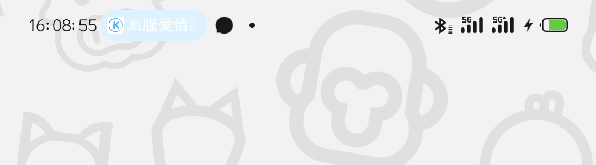
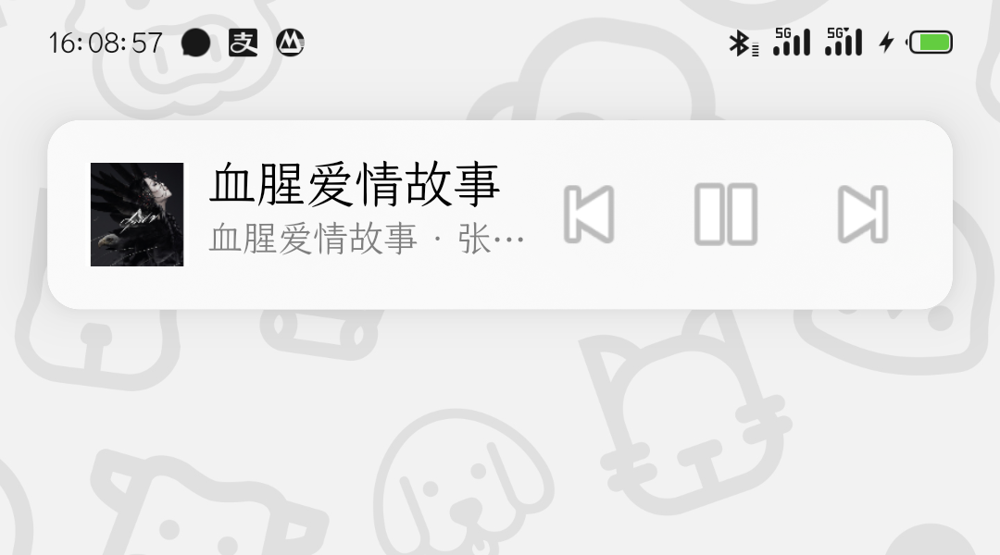
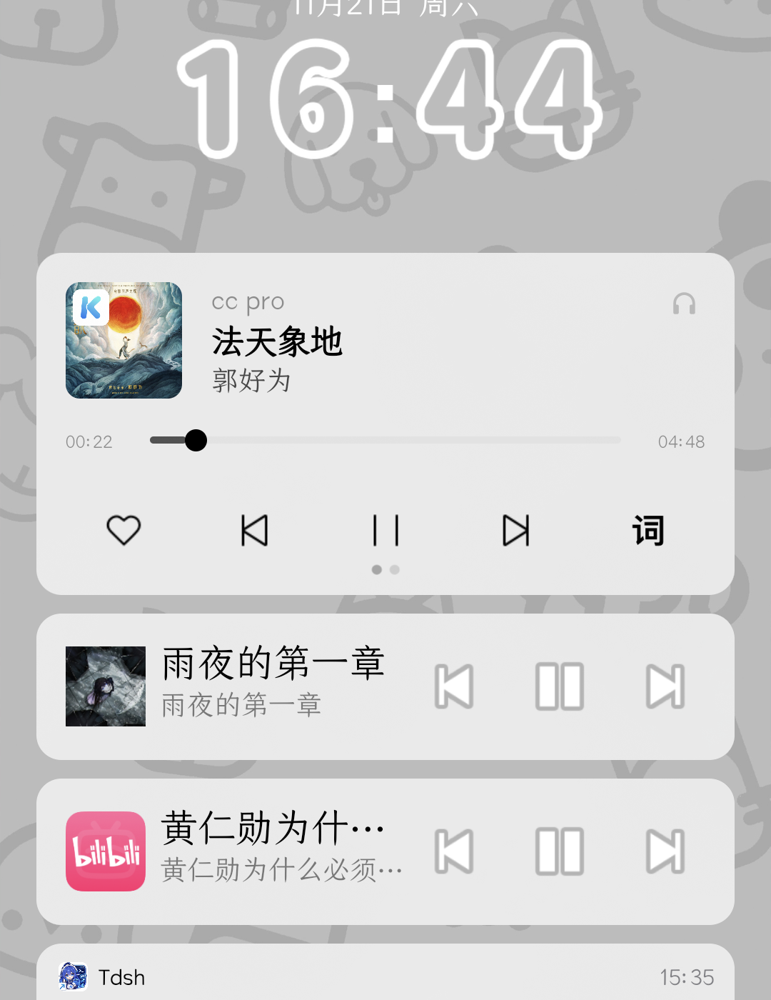
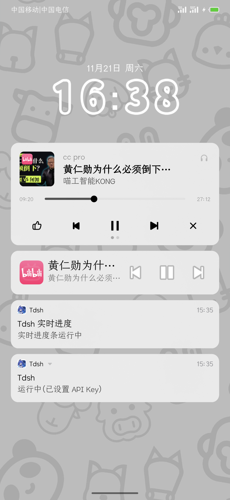

# 笔记：我逆向出了魅族实况通知协议，而且不用 hook 系统

> 配图见文末，协议全文在仓库里。
> 关键词：Flyme 实况通知 / 魅族胶囊 / notification.live.capsule / MediaSession 镜像

## 起因

酷狗概念版放歌时，状态栏有实况胶囊，但 B站、网易云这些 App 没有。
网上能找到的方案基本都是 LSPosed 钩子（比如 FlymeArk，确实牛），
要改 SystemUI、刷机级风险，Flyme 一升级就可能挂。

我就想试一个笨办法：**不碰系统，普通 App 能不能自己发实况通知？**

答案：**能。**

## 第一步：胶囊出来了



左边是酷狗图标，背景是**从酷狗图标取的色**（浅蓝），右边是歌名。
这就是系统原生的胶囊 —— 不是悬浮窗，是 SystemUI 自己画的。

## 原理，其实很简单

实况通知 = **普通通知 + 一堆 `notification.live.*` extras**。
关键字段（完整表在 protocol.md）：

```
notification.live.capsule   → Bundle:
  capsuleContent   = 歌名
  capsuleIcon      = App 图标
  capsuleStatus    = 1      ← 必须为 1，不然不显示
  capsuleBgColor   = 图标平均色
  capsuleType      = 1
```

再配一个白名单（root 写一次）：

```bash
settings put system mz_app_support_livenotification_pkgs "<现有>,你的包名"
```

就这两步，胶囊就出来了。

## 第二步：展开卡片，封面按钮都有



卡片左侧图标 = `notification.live.iconOverlay`（放专辑封面图），
文字 = `titleOverlay` / `contentOverlay`，
按钮 = `feature.extendImage`。

**一个大坑**：extendImage 的显示顺序是**反的** ——
`extendImage[0]` 显示在最右边。想显示「⏮ ⏸ ⏭」，数组要按 `[⏭, ⏸, ⏮]` 放。

## 第三步：两条通知，一条 B站一条音乐



因为胶囊和"系统媒体卡片"是**互斥的**（加了 MediaStyle 胶囊就消失），
干脆发两条：一条实况（胶囊+卡片），一条 MediaStyle（系统媒体卡片）。

每个会话独立一条，按钮用广播 + slot 路由，互不干扰。
最多 4 路并存，B站 + 酷狗 + 概念版同时开着也能各管各的。

## 几个实测结论

- **媒体类 App 零适配**：`MediaSessionManager.getActiveSessions()` 自动发现，
  元数据、封面、状态、控制全都能拿
- **B站也能抓**：它的会话叫 `HeadsetControlPlayAdapter.Session`，
  状态是 PLAYING，元数据就是视频标题 —— 别按包名写死过滤
- **前台优先**：`UsageStatsManager` 查最近 RESUMED 的包名，
  正在看的那个 App 优先接管（要 `appops set ... GET_USAGE_STATS allow`）
- **关掉 App 自动消失**：会话 STOPPED/NONE → 清槽 + cancel
- **性能**：按 `标题|歌手|状态|封面` 签名判断变化，只在变化时 notify，
  千万别用播放进度触发更新（每秒 notify 会卡）

## 和 FlymeArk 什么关系

FlymeArk 是 LSPosed 路线，覆盖微信/QQ/导航/耳机，功能更深。
我这个是**应用层路线**：零 hook、零改系统，卸载即恢复。
算是补充证明"另一条路也能走通"，不是替代。

## 限制（先说清楚）

- 仅 Flyme，其他厂商协议完全不同
- 白名单要 root 写一次（设置页开关能否替代，还没验证）
- 非媒体 App（比如美团外卖 ETA）没有 MediaSession，只能逐家解析通知文本
- Flyme 12 实测，其他版本可能字段有变

## 仓库

协议字段表、可行性矩阵、实现要点、兼容性说明都在仓库里：

`https://github.com/xuanshenikun/xuanshenikun-flycaps`

研究性质，改机有风险，玩之前先备份。


